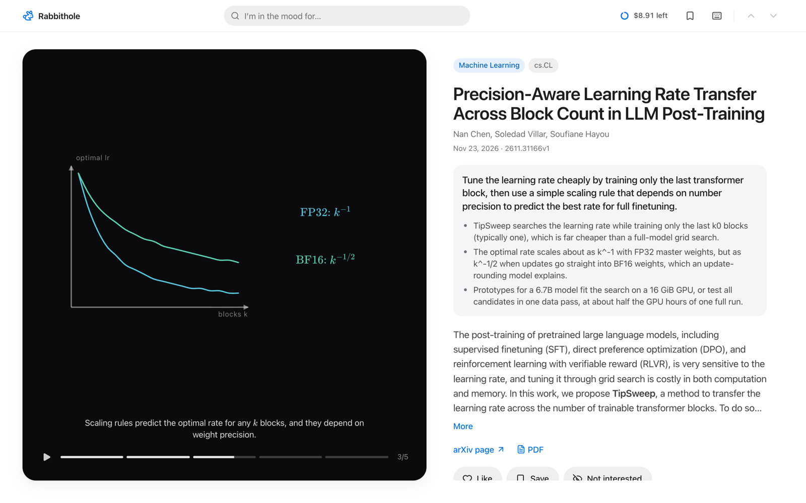
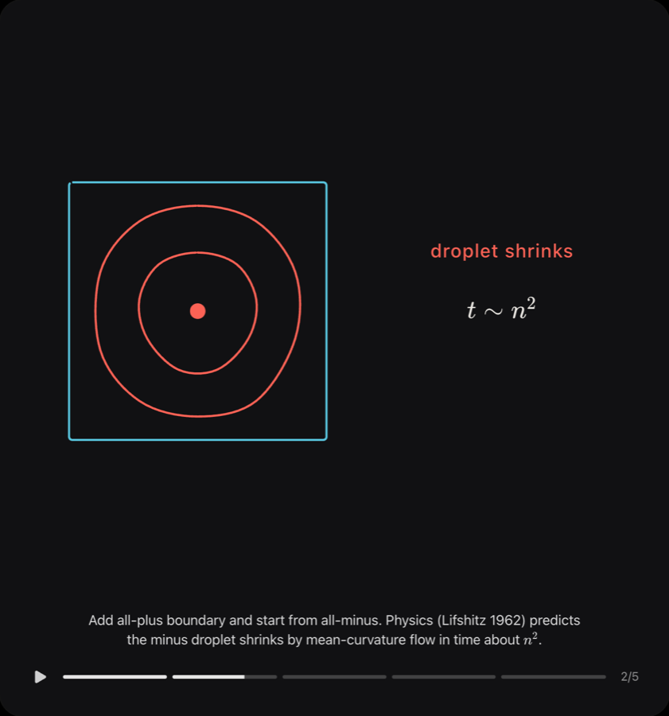
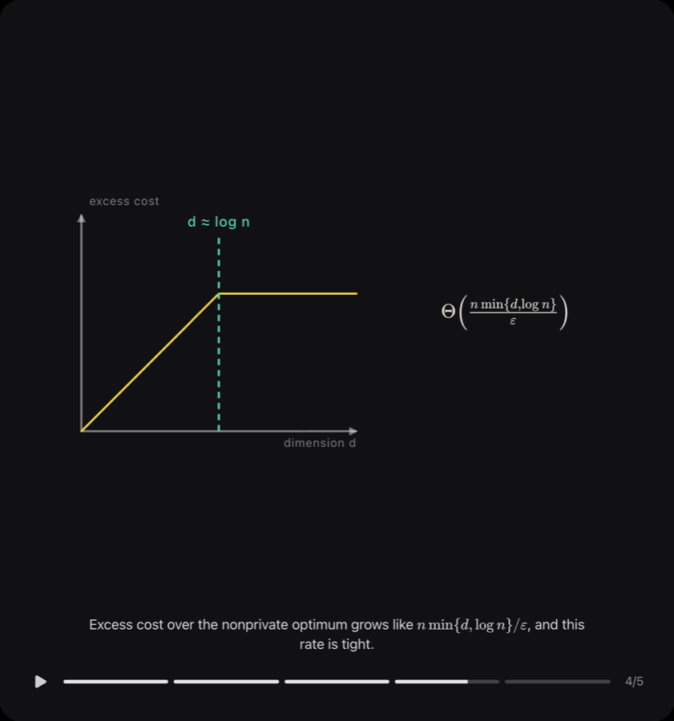
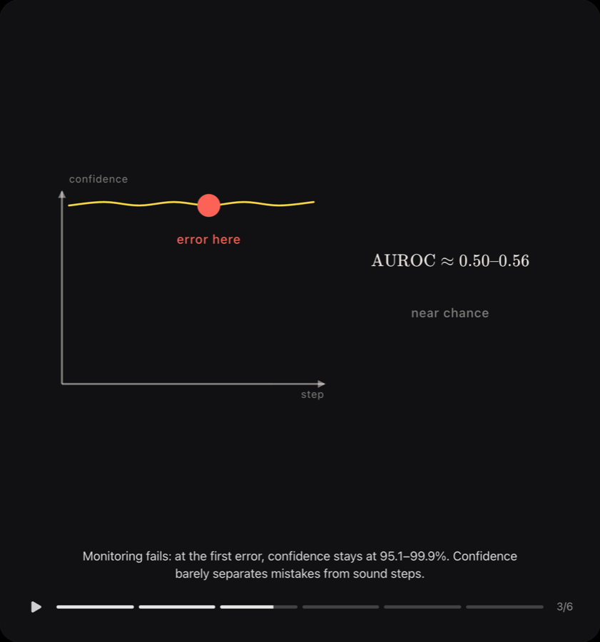

# Rabbithole

A full-screen feed of new arXiv papers, one per screen, like scrolling short videos but for research. Each paper gets an animated explainer on the left and the abstract with a plain-English summary on the right. Tell it what you're in the mood for and the feed bends around it.



## Explainers

Every explainer is drawn fresh from the paper's abstract: axes, curves, points and typeset formulas that build up one scene at a time.

<table>
  <tr>
    <td width="33%"></td>
    <td width="33%"></td>
    <td width="33%"></td>
  </tr>
  <tr>
    <td align="center"><sub>Polynomial mixing for 2D Ising</sub></td>
    <td align="center"><sub>Matching under metric privacy</sub></td>
    <td align="center"><sub>LLM self-monitoring</sub></td>
  </tr>
</table>

## What it can do

- **Explain papers visually.** Each paper gets a short animated explainer in the spirit of 3Blue1Brown: shapes, curves, data points and formulas that build up the core idea one scene at a time, with captions. A one-line TL;DR and three key points appear next to the abstract.
- **Follow your mood.** Type something loose like "weird physics", "practical LLM agents" or "black holes", and the feed is rebuilt around it: Rabbithole expands your words into real arXiv searches, then ranks what comes back by how well it matches.
- **Learn your taste.** Likes, saves, "not interested", and papers you skip quickly all nudge what shows up next. It also avoids showing you the same paper twice and keeps near-duplicates apart.
- **Keep everything on your device.** Likes, saves and history live in your browser. There's no account.
- **Render math properly.** LaTeX in titles, abstracts and explainers is typeset, so you see real formulas rather than raw `$\sum$` markup.
- **Feel at home.** Light and dark mode follow your system. Everything works from the keyboard, and reduced-motion settings are respected.

## How to use it

- **Scroll** with a trackpad, mouse wheel, touch or the keyboard. One gesture moves exactly one paper.
- **Set a mood** in the search bar at the top (or press `/`). Clear it to go back to a mixed feed of what's new.
- **Watch the explainer.** It plays on its own for the paper on screen. Pause it, or tap a segment of the progress bar to jump to a scene. While a new explainer is being made you'll see an animated title card, which swaps for the real one as soon as it's ready.
- **React** with Like, Save or Not interested under the abstract (or `L`, `S`, `X`). The more you react, the better the feed gets.
- **Find saved papers** behind the bookmark button in the top bar, each linking to its arXiv page.
- **Read more:** "More" expands the full abstract, and long author lists expand too.

## Keyboard shortcuts

| Keys | Action |
|---|---|
| `↓` `J` `Space` | Next paper |
| `↑` `K` `Shift Space` | Previous paper |
| `Home` / `End` | First / last paper |
| `L` | Like |
| `S` | Save |
| `X` | Not interested |
| `/` | Set a mood (`Esc` cancels) |
| `?` | Show all shortcuts |

## Run it

```bash
npm install
cp .env.example .env.local   # add your ANTHROPIC_API_KEY
npm run dev                  # http://localhost:3000
```

It works without an API key too: moods fall back to keyword search, and every paper gets the animated title card instead of a full explainer.

## How good is the feed?

An offline eval (`npm run eval:rank`) scores the first page for 30 moods against relevance labels, on a frozen pool of 322 cached arXiv papers. CI fails if the scores drop.

| | Clearly relevant in the first 8 | nDCG@10 |
|---|---|---|
| Claude's search plan (what the app does) | 44% | 0.53 |
| Searching the mood's own words (no API key) | 37% | 0.45 |
| Ranking every paper in the pool | 57% | 0.75 |

Claude's plans beat plain keyword search, but they're strict: on this small pool their searches find only about a third of the relevant papers, and that limits the feed more than ranking does. The labels come from an LLM judge, and the pool is small and skewed, so treat these as directional. See [eval/rank](eval/rank/README.md) for the method and caveats.

Explainers are checked too (`npm run eval:faithfulness`): an LLM judge traces every TL;DR, key point, caption and on-screen label back to the abstract. 4.8% of claims were unsupported at first, almost all of them in the animations. A prompt change cut that from 11.3% to 2.0% on the explainers that had problems. See [eval/faithfulness](eval/faithfulness/README.md).
